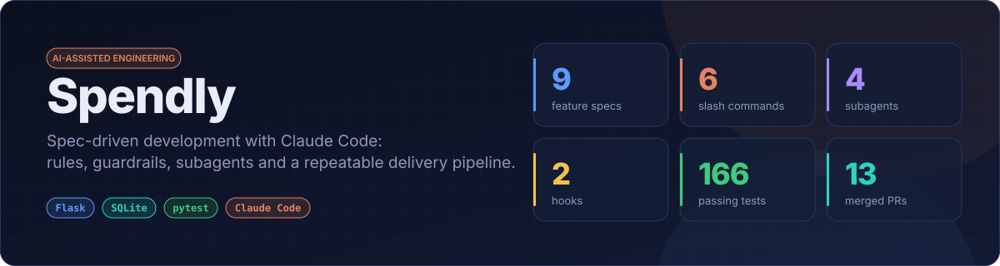
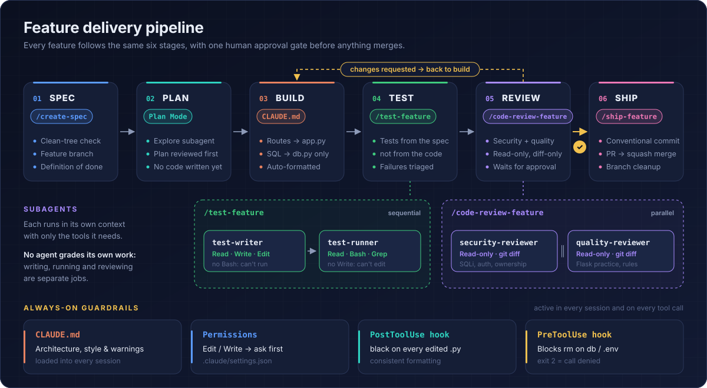
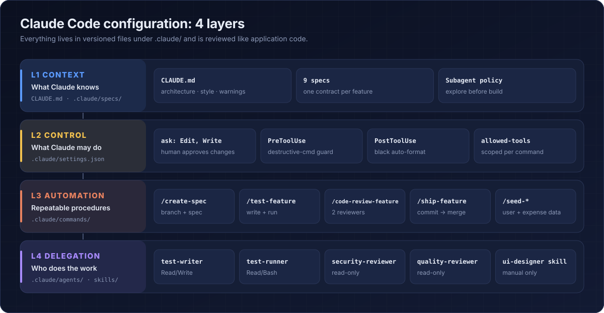
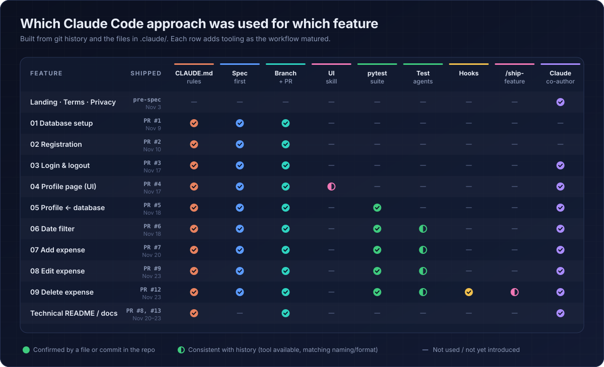
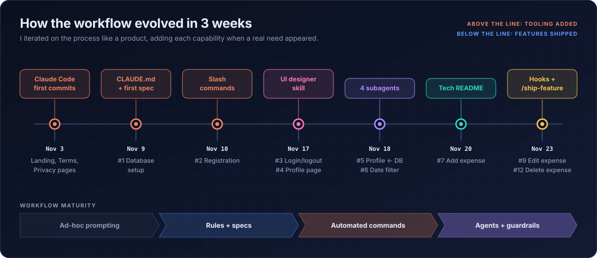

<p align="center">
  
</p>

> **Note:** The expense tracker is just the test project. What this repo really shows is **how I work with Claude Code**: I set it up with rules, guardrails, and repeatable workflows, and every feature goes through the same process: **spec → plan → build → test → review → ship**.

---

## 1. The delivery pipeline

<p align="center">
  
</p>

| Stage | Tool | What it guarantees |
|---|---|---|
| **Spec** | `/create-spec` | Clean working tree, its own feature branch, and a written definition of done before any code |
| **Plan** | Plan Mode | I review the plan before anything is implemented |
| **Build** | `CLAUDE.md` + hooks | Code follows the project architecture and is auto-formatted |
| **Test** | `/test-feature` | Tests come from the **spec, not the code**, written and run by separate agents |
| **Review** | `/code-review-feature` | Read-only security and quality reviews run in parallel, then **wait for my approval** |
| **Ship** | `/ship-feature` | Conventional commit, PR, squash merge, branch cleanup |

---

## 2. How Claude Code is configured

<p align="center">
  
</p>

I set up Claude Code in four layers, all as versioned files in `.claude/`:

- **Context:** what Claude knows (`CLAUDE.md`, feature specs)
- **Control:** what Claude may do (permissions, hooks, per-command tool limits)
- **Automation:** repeatable procedures (slash commands)
- **Delegation:** who does the work (subagents with restricted tools, plus a UI skill)

---

## 3. Which approach was used for which feature

<p align="center">
  
</p>

This matrix is built from the git history and the files in `.claude/`. A filled circle means a file or commit proves the approach was used. A half circle means the tool was available and the output matches its format, but no run log is committed.

---

## 4. How the workflow evolved

<p align="center">
  
</p>

I didn't set everything up on day one. I added each capability when a real need came up: rules and specs first, then commands to make them repeatable, then agents and hooks to enforce quality automatically.

---

## Key engineering decisions

| Decision | Why |
|---|---|
| **Read-only reviewers** | A reviewer that can edit might quietly change the code it's reviewing |
| **Test writer can't run tests; test runner can't edit** | No agent grades its own work |
| **Tests written from the spec** | Tests check what the feature *should* do, not just what the code happens to do |
| **Hooks instead of instructions** | Formatting and the destructive-command guard don't rely on the model remembering a rule |
| **Edit/Write require approval** | I stay in control of every change |
| **Configuration is versioned** | Rules and agents get reviewed and improved like code |

**Known gaps (on purpose):** `/ship-feature` doesn't force a review first, the hook guard matches text instead of parsing commands, and some docs have drifted from the code. Finding and writing these down is part of the work.

---

## The app (Spendly)

A simple expense tracker: register/login, add, edit and delete expenses, filter by date, and see a category breakdown.

**Stack:** Python · Flask · SQLite · Jinja2 · vanilla JS · pytest (166 tests)

```bash
python -m venv venv
source venv/bin/activate      # Windows: venv\Scripts\activate
pip install -r requirements.txt
python app.py                 # http://localhost:5001
pytest
```

Demo login: `demo@spendly.com` / `demo123`

<details>
<summary>Repository layout</summary>

```
CLAUDE.md              → project rules loaded into every session
.claude/
├── settings.json      → permissions + 2 hooks
├── commands/          → 6 slash commands
├── agents/            → 4 subagents
├── skills/            → UI design skill (runs only when I ask)
└── specs/             → 9 feature specs (01–09)
app.py                 → all Flask routes
database/db.py         → all SQL (parameterised)
templates/ static/     → Jinja2 pages, CSS, vanilla JS
tests/                 → pytest suite, isolated temp DB per test
docs/assets/           → README graphics (SVG)
```
</details>

---

<sub>Built with <a href="https://claude.com/claude-code">Claude Code</a>.</sub>