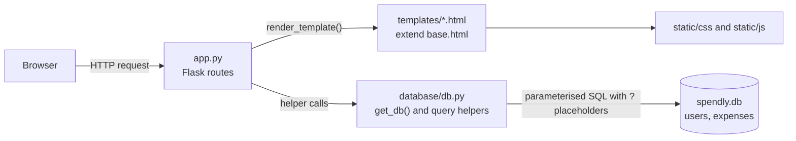
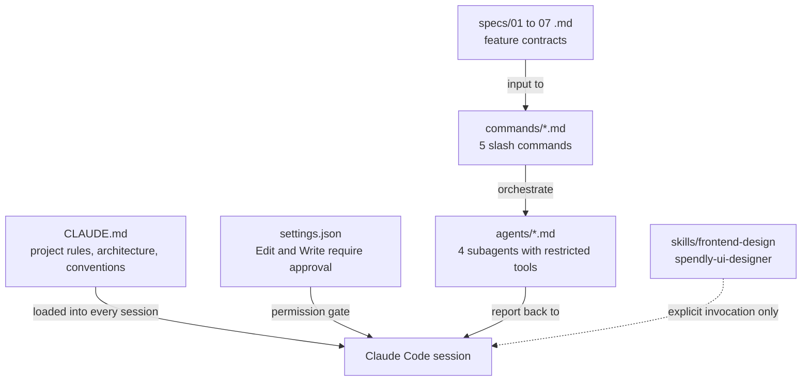
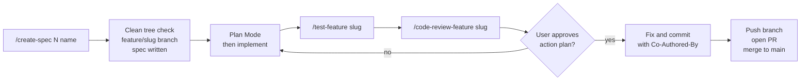
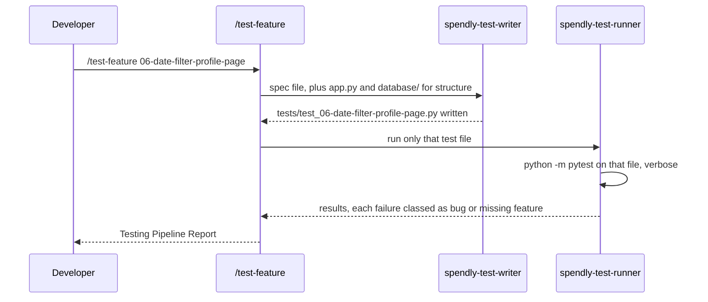
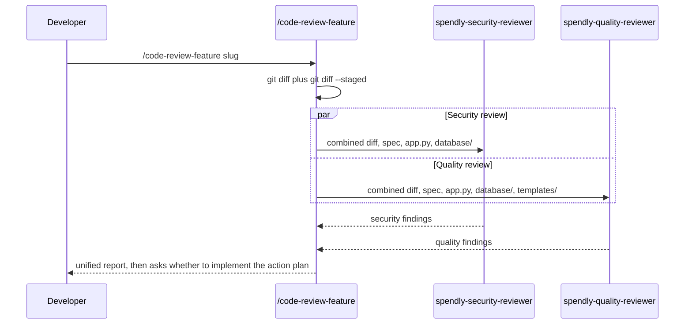
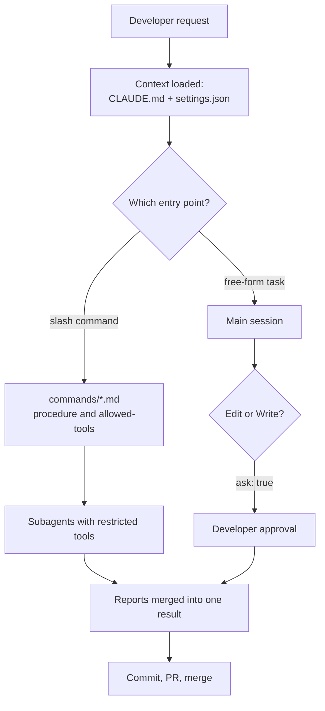

# Spendly — A Flask Expense Tracker Built with Claude Code

Spendly is a lightweight personal expense tracker built with **Flask**, **SQLite**, server-rendered **Jinja2** templates and **vanilla JavaScript**. It was developed step by step, with [Claude Code](https://claude.com/claude-code) as the primary development tool. This README documents both the application and **how Claude Code was configured and used** to build it: its project instructions, custom slash commands, subagents, skill, permission model, and the spec-driven Git workflow that connects them.

Every Claude Code claim below is tied to a file in this repository. Claims are labelled by how they can be verified:

| Label | Meaning |
|---|---|
| ✅ **Verified** | Confirmed by a file in the repo or by Git history |
| 🔶 **Consistent with history** | The repo shows a pattern that matches the feature, but no transcript or output proves it ran |
| ⚪ **Not used** | Checked and absent from the repo |

---

## Table of Contents

1. [Project Overview](#1-project-overview)
2. [Project Architecture](#2-project-architecture)
3. [Claude Code: Overview and Role in This Project](#3-claude-code-overview-and-role-in-this-project)
4. [Claude Code Features and Their Implementations](#4-claude-code-features-and-their-implementations)
5. [Feature-to-File Mapping](#5-feature-to-file-mapping)
6. [Development Workflow](#6-development-workflow)
7. [Architecture and Workflow Diagrams](#7-architecture-and-workflow-diagrams)
8. [Real Implementation Examples](#8-real-implementation-examples)
9. [Engineering Decisions and Best Practices](#9-engineering-decisions-and-best-practices)
10. [Testing, Validation, and Quality Assurance](#10-testing-validation-and-quality-assurance)
11. [Git and GitHub Workflow](#11-git-and-github-workflow)
12. [Key Learnings and Technical Takeaways](#12-key-learnings-and-technical-takeaways)
13. [Known Gaps and Documentation Drift](#13-known-gaps-and-documentation-drift)
14. [Getting Started](#14-getting-started)
15. [Conclusion](#15-conclusion)

---

## 1. Project Overview

Spendly lets a registered user record expenses, see summary statistics, filter their history by date range, and review a per-category breakdown.

**Implemented on `main`:**

- Landing, Terms and Privacy pages
- Registration and login with hashed passwords (`werkzeug.security`) and session-based auth
- Profile page showing summary stats, recent transactions and category breakdown, with a date-range filter (`start_date` / `end_date` query parameters)
- Add-expense form (`GET` + `POST /expenses/add`) with server-side validation, bounded input sizes and a fixed category list
- Analytics page (rendered behind login; content is a placeholder)

**Not yet implemented:** edit (`/expenses/<id>/edit`) and delete (`/expenses/<id>/delete`). Both still return placeholder strings in `app.py` and are the planned next steps in the roadmap.

**Stack** (from `requirements.txt`): Flask 3.1.3, Werkzeug 3.1.6, pytest 8.3.5, pytest-flask 1.3.0. Python 3.10+.

The roadmap is organised as numbered specs in `.claude/specs/` (01 through 07). Each spec is the contract for one feature branch.

---

## 2. Project Architecture

### Directory layout

```
expense-tracker/
├── app.py                  # All routes (single file, no blueprints)
├── database/
│   └── db.py               # SQLite helpers: get_db, init_db, seed_db, query helpers
├── templates/
│   ├── base.html           # Shared layout; every page extends it
│   └── *.html              # One template per page (landing, login, profile, add_expense, ...)
├── static/
│   ├── css/                # style.css (global) + page-specific stylesheets
│   ├── img/analytics/      # SVG assets for the analytics page
│   └── js/main.js          # Vanilla JS only
├── tests/
│   ├── conftest.py         # Shared fixtures: test_db, client, auth_client, ...
│   └── test_*.py           # Feature test files
├── .claude/                # Claude Code configuration (see Section 3)
├── CLAUDE.md               # Project instructions read by Claude Code
└── requirements.txt
```

### Runtime architecture



The layering is deliberately flat: routes fetch data and render templates, and every SQL statement lives in `database/db.py`. That split is enforced by `CLAUDE.md` and reinforced by the Claude Code reviewer agents described below.

---

## 3. Claude Code: Overview and Role in This Project

Claude Code was used across the whole project lifecycle, from writing project rules to reviewing and committing changes. What distinguishes this repository is that Claude Code's configuration is **versioned alongside the application**. The `.claude/` directory is committed, so the instructions, commands, agents and specs that shaped each feature are visible in Git history.

### The `.claude/` configuration at a glance



### Confirmed vs. inferred usage

| Area | Status | Basis |
|---|---|---|
| Project instructions (`CLAUDE.md`) | ✅ Verified | Committed in `7a0aa66` and `e256953`; contains architecture, code-style and warning sections |
| Slash commands (5) | ✅ Verified (definitions) | Added in `c9e945b` and `8085ebc`; each has frontmatter and a full procedure |
| Subagents (4) | ✅ Verified (definitions) | Added in `8085ebc`; each has `tools:` and `model:` frontmatter |
| Skill (1) | ✅ Verified (definition) | Added in `f04f617` |
| Permission configuration | ✅ Verified | `.claude/settings.json` |
| Spec-driven development | ✅ Verified | Seven spec files in `.claude/specs/`, one per feature branch |
| Feature branches and PRs | ✅ Verified | Branch names and merge commits in Git history (Section 11) |
| `/create-spec` workflow | 🔶 Consistent with history | Branch names such as `feature/login-logout` and numbered spec files match the command's naming rules |
| `/test-feature` workflow | 🔶 Consistent with history | Only `tests/test_06-date-filter-profile-page.py` follows the command's `tests/test_$ARGUMENTS.py` output name; other test files were named differently |
| `/code-review-feature` workflow | 🔶 Consistent with history | Command and reviewer agents exist, but no review reports are committed, so runs cannot be confirmed |
| Co-authored commits | ✅ Verified | 10 of 23 commits on `origin/main` carry a `Co-Authored-By: Claude Haiku 5.5` trailer |
| Local plan files | 🔶 Present but not in the repo | Three files exist in `.claude/plans/`; the directory is in `.gitignore`, so they are not in Git history |
| Hooks | ⚪ Not used | No `hooks` key in `.claude/settings*.json` |
| MCP servers (project-level) | ⚪ Not used | No `.mcp.json` in the repository |

---

## 4. Claude Code Features and Their Implementations

Each feature below follows the same structure: what it is, how it works, why it is useful here, where it lives, and how it was applied.

### 4.1 Project instructions — `CLAUDE.md`

**What it is.** `CLAUDE.md` is a Markdown file that Claude Code loads automatically at the start of a session. It acts as persistent, version-controlled memory for project rules.

**How it works.** Its contents are injected into the context on every run, so rules hold across sessions and across different tasks without being repeated in each prompt.

**Why it is useful.** Without it, every new session would have to rediscover the architecture, the style rules and the list of forbidden shortcuts. Stating them once makes the assistant's output consistent with the codebase.

**Where it lives.** `CLAUDE.md` at the repository root.

**How it was used.** The file contains these project-specific sections:

- **Where things belong:** new routes go in `app.py` only; DB logic goes in `database/db.py` only.
- **Code style:** parameterised queries only (`?` placeholders, never f-strings in SQL); `abort()` for HTTP errors; `url_for()` for every internal link.
- **Tech constraints:** Flask and SQLite only; vanilla JS only; no new pip packages without flagging them.
- **Subagent policy:** when to use exploration, planning and test-verification subagents.
- **Warnings:** for example, "FK enforcement is manual — `get_db()` must run `PRAGMA foreign_keys = ON`" and "the app runs on port 5001, not 5000".

**Benefits.** Architectural rules are written down in one place, so they are reviewable and can be changed deliberately. The FK-pragma rule is a good example: it is a non-obvious SQLite default that `get_db()` now satisfies on every connection (Section 8.4).

### 4.2 Custom slash commands — `.claude/commands/`

**What it is.** A slash command is a Markdown file with frontmatter (`description`, `allowed-tools`, optional `argument-hint`) whose body is a procedure. Typing `/name args` runs that procedure, with `$ARGUMENTS` replaced by the arguments.

**How it works.** Frontmatter declares which tools the command may use. For example, `/test-feature` may only run `python -m pytest`, while `/create-spec` may use `Bash(git:*)`. The body then describes the steps, the stop conditions and the output format.

**Why it is useful.** A repeatable process is encoded once instead of re-typed. Restricting `allowed-tools` limits what a command can do.

**Where it lives and what each command does:**

| Command | File | Allowed tools | Purpose |
|---|---|---|---|
| `/create-spec` | `.claude/commands/create-spec.md` | `Read, Write, Glob, Bash(git:*)` | Checks the tree is clean, creates a `feature/<slug>` branch, researches the codebase and writes a spec |
| `/code-review-feature` | `.claude/commands/code-review-feature.md` | `Bash(git diff)`, `Bash(git diff --staged)` | Collects the diff, runs two reviewers in parallel, produces a unified report, then waits for approval |
| `/test-feature` | `.claude/commands/test-feature.md` | `Bash(python -m pytest)` | Has a test-writer write tests from the spec, then a test-runner runs only that file |
| `/seed-user` | `.claude/commands/seed-user.md` | `Read, Bash(python3:*)` | Creates one dummy user with a unique generated email |
| `/seed-expenses` | `.claude/commands/seed-expenses.md` | `Read, Bash(python3:*)` | Inserts N expenses for a user, spread over M months, in a single transaction |

**How it was used.** `/create-spec` encodes the team's Git and spec rules: it refuses to start with a dirty tree, slugifies the feature name, avoids branch-name collisions by appending `-01`, `-02` and so on, and forces the output into a fixed spec template (Section 8.2).

**Benefits.** The Git and spec procedure is the same for every feature, and reviewers can read it in the repository.

### 4.3 Subagents — `.claude/agents/`

**What it is.** A subagent is a separately configured assistant with its own system prompt, model and tool list. Claude Code can delegate a sub-task to it, and only its final report returns to the main session.

**How it works.** Each agent file has YAML frontmatter (`name`, `description`, `tools`, `model`, optionally `color`) and a system prompt in the body. The `tools:` line is enforced: an agent cannot use tools it does not list.

**Why it is useful.** Restricting tools creates separation of duties. A reviewer that cannot edit files cannot "fix" what it was asked to review, and a test-writer that cannot run code cannot pass tests by tuning implementation details.

**Where it lives and how each agent is restricted:**

| Agent | File | Tools (from frontmatter) | Model | Role |
|---|---|---|---|---|
| `spendly-test-writer` | `.claude/agents/spendly-test-writer.md` | `Read, Edit, Write, Grep, Glob` | sonnet | Writes pytest tests from the **spec**, not the implementation |
| `spendly-test-runner` | `.claude/agents/spendly-test-runner.md` | `Read, Bash, Grep` | sonnet | Runs one test file and classifies each failure as a bug or a missing feature |
| `spendly-security-reviewer` | `.claude/agents/spendly-security-reviewer.md` | `Read, Grep, Glob, Bash(git diff)` | sonnet | Reviews only the changed code for security issues |
| `spendly-quality-reviewer` | `.claude/agents/spendly-quality-reviewer.md` | `Read, Grep, Glob, Bash(git diff)` | sonnet | Reviews only the changed code for quality and Flask practice |

Both reviewers are read-only: their tool lists contain no `Edit` or `Write`.

**How they were used.** The commands `/test-feature` and `/code-review-feature` orchestrate the agents. The procedures impose ordering: the test-runner must not start until the test-writer has finished, and the two reviewers must run in parallel on the same diff.

**Benefits.** Separation of duties, a narrow context per agent (each sees only the diff, the spec and a few source files), and independent perspectives on the same change.

### 4.4 Skills — `.claude/skills/`

**What it is.** A skill is a packaged instruction set that Claude can load for a class of tasks. It differs from a command in that its frontmatter can control *who* may invoke it.

**How it works.** The skill file's frontmatter sets `disable-model-invocation: true`, which means Claude must not load it on its own initiative. It runs only when the user invokes it explicitly.

**Where it lives.** `.claude/skills/frontend-design/SKILL.md`. Its frontmatter `name` is `spendly-ui-designer`. Its description targets fintech-style Flask, Jinja2 and vanilla-CSS UI, and says that it should not generate React or Tailwind output.

```yaml
---
name: spendly-ui-designer
disable-model-invocation: true
---
```

**Provenance.** The skill's description refers to an upstream repository (`campusx-official/spendly`). The file was added in commit `f04f617`, but its authorship has not been verified.

**Why it is useful.** Design guidance for the stack is written down, so UI work stays consistent with the vanilla CSS and Jinja2 approach. Restricting invocation to explicit requests stops the skill from triggering on unrelated tasks.

### 4.5 Permissions and security — `.claude/settings.json`

**What it is.** Claude Code's permission system decides whether each tool call runs automatically, asks first, or is denied.

**Where it lives.** `.claude/settings.json` (committed), which sets the default mode and a list of tools that always ask:

```json
{
  "permissions": {
    "defaultMode": "default",
    "ask": [
      "Edit",
      "Write"
    ]
  }
}
```

**How it was used.** File-modifying tools require confirmation in this repository. The reviewer agents combine this with tool lists that exclude edits. Together these make the review step read-only by construction.

**Local overrides.** A `.claude/settings.local.json` file also exists for machine-specific permissions. A global Git ignore rule excludes it from the repository, so its contents are not documented here.

### 4.6 Spec-driven development — `.claude/specs/` and `.claude/plans/`

**What it is.** A spec is a short Markdown contract describing one feature: overview, dependencies, routes, database changes, templates, files to create or modify, rules, and a testable definition of done.

**Where it lives.** Seven committed specs, `01-database-setup.md` through `07-add-expense.md`. Plans (`.claude/plans/01` to `03`) exist locally but are gitignored.

**How it was used.** The spec is the input to three steps:

1. `/create-spec` writes it.
2. `/test-feature` derives tests from it. The test-writer's instructions say it must not read the implementation.
3. `/code-review-feature` passes it to reviewers as context.

**Why it is useful.** A written contract defines "done" before the code exists, and it gives tests and reviews a source of truth other than the code under review.

**Observed drift.** Spec 07 says `insert_expense` belongs in `database/queries.py`. The implementation places it in `database/db.py`, which is where `CLAUDE.md` says DB logic must live. The code follows the project rule, and the spec is out of date (Section 13).

### 4.7 Git and GitHub workflow

**Where it lives.** The `create-spec` command's branch rule, the Git history, and the `Co-Authored-By` trailers.

**How it was used.** Each feature has its own `feature/<slug>` branch and is merged through a pull request. Commits made with Claude Code carry this trailer:

```
Co-Authored-By: Claude Haiku 5.5 <noreply@anthropic.com>
```

**Benefits.** Attribution is explicit in history, and each feature can be reviewed as a single unit (Section 11).

### 4.8 Features checked and not used

| Feature | Status | Note |
|---|---|---|
| Hooks | ⚪ Not used | `.claude/settings.json` has no `hooks` key, so no automatic pre- or post-tool actions are configured |
| Project-level MCP servers | ⚪ Not used | No `.mcp.json` exists |
| Headless or CI runs | ⚪ Not used | No CI configuration file is present in the repository |

Listing these explicitly keeps the feature inventory honest. Documenting only what is used is more useful than documenting everything Claude Code can do.

---

## 5. Feature-to-File Mapping

| Claude Code feature | Implementation file(s) | Introduced in | What it governs |
|---|---|---|---|
| Project instructions | `CLAUDE.md` | `7a0aa66`, `e256953` | Architecture, style, constraints, warnings |
| Slash: `/create-spec` | `.claude/commands/create-spec.md` | `c9e945b` | Clean-tree check, branch naming, spec template |
| Slash: `/seed-user` | `.claude/commands/seed-user.md` | `c9e945b` | Dummy user creation |
| Slash: `/seed-expenses` | `.claude/commands/seed-expenses.md` | `c9e945b` | Dummy expense generation |
| Slash: `/test-feature` | `.claude/commands/test-feature.md` | `8085ebc` | Test-writer then test-runner pipeline |
| Slash: `/code-review-feature` | `.claude/commands/code-review-feature.md` | `8085ebc` | Parallel review and approval gate |
| Subagent: test-writer | `.claude/agents/spendly-test-writer.md` | `8085ebc` | Spec-based test generation |
| Subagent: test-runner | `.claude/agents/spendly-test-runner.md` | `8085ebc` | Single-file test execution and triage |
| Subagent: security reviewer | `.claude/agents/spendly-security-reviewer.md` | `8085ebc` | Read-only security review of the diff |
| Subagent: quality reviewer | `.claude/agents/spendly-quality-reviewer.md` | `8085ebc` | Read-only quality review of the diff |
| Skill: UI designer | `.claude/skills/frontend-design/SKILL.md` | `f04f617` | Stack-specific UI guidance (explicit invocation only) |
| Permissions | `.claude/settings.json` | `93b8d23` | Edit and Write require approval |
| Specs | `.claude/specs/01` to `07` | `7a0aa66` onward | Feature contracts used by tests and reviews |
| Feature branches and PR merges | Git history | From `e0cf9d5` onward | One branch and one PR per feature |
| Co-author attribution | Commit messages | From `93b8d23` onward (first trailer) | Records Claude's contribution |

---

## 6. Development Workflow

The sequence below is the workflow the repository's configuration describes. Each stage points to the file that defines it, and the stages marked 🔶 are shown by the configuration and branch history rather than by captured output.

| Stage | What happens | Where it is defined | Status |
|---|---|---|---|
| 1. Set rules | Architecture, style and constraints are written to `CLAUDE.md` | `CLAUDE.md` | ✅ |
| 2. Start a feature | `/create-spec N name` checks a clean tree, creates `feature/<slug>`, and writes a spec | `create-spec.md`, `specs/` | 🔶 |
| 3. Plan | The spec tells the developer to enter Plan Mode before implementing | `create-spec.md` (Step 9), local `.claude/plans/` | 🔶 |
| 4. Implement | Code goes into the layers that `CLAUDE.md` defines: routes in `app.py`, SQL in `database/db.py`, pages in `templates/` | `CLAUDE.md` | ✅ |
| 5. Test | `/test-feature slug` runs the test-writer, then the test-runner on that single file | `test-feature.md`, `spendly-test-*.md` | 🔶 |
| 6. Review | `/code-review-feature slug` runs both reviewers in parallel and waits for approval | `code-review-feature.md`, `spendly-*-reviewer.md` | 🔶 |
| 7. Commit | Commit with the Claude co-author trailer | Git history | ✅ |
| 8. Integrate | Push the branch, open a PR, merge into `main` | Git history (`#1` to `#7`) | ✅ |

---

## 7. Architecture and Workflow Diagrams

### 7.1 Feature delivery pipeline

This diagram shows the process a feature follows from specification to merge. The loop back from approval to implementation reflects the review gate in `code-review-feature.md`, which forbids edits before the user approves.



### 7.2 `/test-feature` sequence

The writer and the runner are separate agents, and the runner starts only after the writer has finished. The writer derives its tests from the spec, which is the design choice that keeps the tests from simply mirroring the code.



### 7.3 `/code-review-feature` sequence

The two reviewers run concurrently on the same diff and do not see each other's output. Their findings are merged into one report, and nothing is changed until the developer approves.



### 7.4 How the Claude Code pieces fit together

This diagram maps the request path. It shows which files are read at each step, and where a human decision is required.



---

## 8. Real Implementation Examples

All snippets below are copied from the repository.

### 8.1 Parameterised SQL in the query layer

Every query uses `?` placeholders, as `CLAUDE.md` requires. From `database/db.py`, `insert_expense`:

```python
def insert_expense(user_id, amount, category, expense_date, description):
    """Insert an expense for a user and return its id. description may be None."""
    conn = get_db()
    try:
        with conn:
            cursor = conn.execute(
                """
                INSERT INTO expenses (user_id, amount, category, date, description)
                VALUES (?, ?, ?, ?, ?)
                """,
                (user_id, amount, category, expense_date, description),
            )
            return cursor.lastrowid
```

The `with conn:` block commits on success and rolls back on an exception. The function returns the new row id.

### 8.2 The spec template enforced by `/create-spec`

The command fixes the structure of every spec. Here is the section list it requires:

```markdown
# Spec: <feature_title>
## Overview
## Depends on
## Routes
## Database changes
## Templates
## Files to change
## Files to create
## New dependencies
## Rules for implementation
## Definition of done
```

Spec 07 (`.claude/specs/07-add-expense.md`) follows it. Its route section lists `GET /expenses/add` and `POST /expenses/add`, both marked "logged-in only".

### 8.3 Separation of duties in a subagent definition

From `.claude/agents/spendly-test-writer.md`, the writer's frontmatter and its core rule:

```yaml
name: "spendly-test-writer"
tools: Read, Edit, Write, Grep, Glob
model: sonnet
```

> You write tests based on **feature specifications and expected behavior**, never by reading or reverse-engineering the implementation.

The writer has no `Bash` tool, so it cannot run the tests it writes. Running them is the job of `spendly-test-runner`, which has no `Edit` or `Write` tool.

### 8.4 Enforcing a manual SQLite rule in one place

`CLAUDE.md` states that foreign keys are off by default in SQLite. `database/db.py` turns them on for every connection:

```python
def get_db():
    """Return a SQLite connection with dict-like rows and foreign keys enabled."""
    conn = sqlite3.connect(DB_PATH)
    conn.row_factory = sqlite3.Row
    conn.execute("PRAGMA foreign_keys = ON")
    return conn
```

### 8.5 Input validation with a strict date check

From `app.py`, the add-expense validator rejects inputs that `strptime` would otherwise accept. `strptime` accepts non-zero-padded dates such as `2026-1-5`, so the code compares against the canonical form:

```python
    try:
        parsed = datetime.strptime(date_raw, "%Y-%m-%d")
    except ValueError:
        return "Please enter a valid date.", None
    # strptime accepts non-padded values such as 2026-1-5; keep only canonical YYYY-MM-DD.
    if parsed.strftime("%Y-%m-%d") != date_raw:
        return "Please enter a valid date.", None
```

The same file bounds request size and amount:

```python
app.config["MAX_CONTENT_LENGTH"] = 16 * 1024  # bound the size of any request body
...
AMOUNT_MAX = 10_000_000
```

### 8.6 Routes that render templates and redirect

The add-expense route is a thin handler. It validates, calls one helper, and redirects. From `app.py`:

```python
@app.route("/expenses/add", methods=["GET", "POST"])
def add_expense():
    if not session.get("user_id"):
        return redirect(url_for("login"))
    ...
    error, cleaned = validate_expense(
        form["amount"], form["category"], form["date"], form["description"]
    )
    if error:
        return render_expense_form(form, error)

    insert_expense(
        session["user_id"],
        cleaned["amount"],
        cleaned["category"],
        cleaned["date"],
        cleaned["description"],
    )
    return redirect(url_for("profile"))
```

### 8.7 Isolated test database

The shared fixtures in `tests/conftest.py` point the app at a throwaway database for each test, so tests never touch `spendly.db`:

```python
@pytest.fixture
def test_db(tmp_path, monkeypatch):
    """Point the app at a throwaway SQLite file seeded with the demo user and expenses."""
    path = tmp_path / "test_spendly.db"
    monkeypatch.setattr(db, "DB_PATH", path)
    db.init_db()
    db.seed_db()
    return path
```

---

## 9. Engineering Decisions and Best Practices

| Decision | Reasoning | Evidence |
|---|---|---|
| **Versioned Claude configuration** | Rules, commands and agents are reviewed like code, and their history explains why the codebase looks the way it does | `.claude/` is committed; `CLAUDE.md` changes are in history |
| **Spec-first testing** | The test-writer is told to use the spec rather than the implementation, so tests check intended behaviour rather than restating the code | `spendly-test-writer.md` core rule |
| **Read-only reviewers** | A reviewer that can edit may silently change code under review. The reviewers' tool lists contain no `Edit` or `Write` | `spendly-*-reviewer.md` frontmatter |
| **Approval gate before edits** | `/code-review-feature` requires explicit approval before any change | Rules section of `code-review-feature.md` |
| **Parallel, independent reviews** | Security and quality perspectives are separated, and each reviewer sees only the diff and a narrow set of files | Procedure in `code-review-feature.md` |
| **Scoped permissions** | Commands declare `allowed-tools`, so `/test-feature` can run only pytest | Frontmatter of each command |
| **Single-file test runs** | The runner executes only the file just written, which keeps feedback fast and the report focused | `test-feature.md` Step 2 |
| **Layered code, enforced by rules** | Routes in `app.py`, SQL in `database/db.py`, pages in templates. Separating these layers keeps each one reviewable | `CLAUDE.md` "Where things belong" |
| **Parameterised SQL only** | Prevents SQL injection; enforced by `CLAUDE.md` and checked by the security reviewer's checklist | No f-string SQL found in `app.py` or `database/db.py` |
| **Hashed passwords** | Passwords are stored with `generate_password_hash` and checked with `check_password_hash` | `app.py` register and login routes |
| **Bounded input** | Request size is capped at 16 KB and amounts are capped at 10,000,000 | `app.py` configuration and `validate_expense` |

---

## 10. Testing, Validation, and Quality Assurance

### Test suite

The suite contains **110 tests** in three files. Counts come from `pytest --collect-only`:

| File | Tests | Covers |
|---|---|---|
| `tests/test_backend_connection.py` | 18 | Database helpers, profile data |
| `tests/test_add_expense.py` | 31 | Add-expense validation, auth guard, persistence |
| `tests/test_06-date-filter-profile-page.py` | 61 | Date-range filtering on the profile page |

### Results

Run on the `docs/claude-code-technical-readme` branch with the project's virtual environment:

```
$ venv/bin/python -m pytest -q
110 passed in 10.24s
```

### Test isolation

`tests/conftest.py` gives each test its own temporary database (Section 8.7), so tests are independent and never write to `spendly.db`. Fixtures such as `auth_client` log in through the session, so auth guards are tested the same way the app uses them.

### Quality gates

- **Spec-derived tests** via the test-writer agent
- **Single-file runner** that classifies failures as a bug or a missing feature
- **Two-perspective review** (security and quality) before commit
- **Manual approval** before any review-driven change is applied

---

## 11. Git and GitHub Workflow

### Branching and merges

Each feature has its own branch, named by the `create-spec` rule `feature/<slug>`. The history shows how the branches merged:

| PR | Branch | Feature |
|---|---|---|
| #1 | `feature/database-setup` | Database setup |
| #2 | `feature/registration-01` | Registration (the `-01` suffix is the collision rule in `create-spec`) |
| #3 | `feature/login-logout` | Login and logout |
| #4 | `feature/profile-page` | Profile page |
| #5 | `feature/backend-routes-profile-page` | Profile page backed by the database |
| #6 | `feature/date-filter-profile-page` | Date filter on the profile page |
| #7 | (squashed onto `main`) | Add-expense form and POST handler |

### Attribution

`origin/main` has 23 commits. Ten carry a `Co-Authored-By: Claude Haiku 5.5` trailer, which makes Claude's contribution visible in the history.

### Repository hygiene

- `.gitignore` excludes `.claude/plans/`, virtual environments, `spendly.db`, caches and `.env`
- Specs are committed, so the reasoning behind each feature stays with the code

---

## 12. Key Learnings and Technical Takeaways

1. **Claude Code is configured, not just prompted.** Rules in `CLAUDE.md`, commands, agents and permissions are files. They can be reviewed, versioned and improved, the same as any other part of the codebase.

2. **Tool restrictions are the main safety control.** A reviewer with no edit tool cannot change code, and a test-writer with no shell cannot run its own tests. Declaring `tools:` in frontmatter turns a policy into a constraint.

3. **Separate agents for separate roles.** Writing tests, running them and reviewing code are different jobs. Splitting them avoids one agent grading its own work.

4. **Specs make "done" testable before implementation.** When the test-writer works from the spec, the tests express intent. When the spec drifts from the code (Section 13), that is visible and can be fixed.

5. **Write down the non-obvious rules.** Manual foreign-key enforcement, the non-default port 5001, and the canonical-date check are the kinds of detail a future session would otherwise get wrong. Recording them removes that risk.

6. **Make the workflow mechanical.** Slash commands turn a multi-step procedure (clean-tree check, branch naming, spec template) into something that happens the same way every time.

---

## 13. Known Gaps and Documentation Drift

Being precise about gaps is part of the engineering record. These are the issues found while writing this document:

- **`CLAUDE.md` status table is stale.** It says `database/db.py` is "currently empty" and that `/profile`, `/expenses/add`, and related routes are stubs. On `main`, `db.py` contains the query helpers, `/profile` is implemented (date-filtered), and `/expenses/add` has a full GET and POST handler. Claude Code sessions that rely on the stale table could make wrong assumptions. This is the most important documentation fix.
- **Spec 07 and the code disagree on file location.** The spec names `database/queries.py`. The code uses `database/db.py`. The code follows `CLAUDE.md`, so the spec should be updated.
- **Test file naming is inconsistent.** Only `test_06-date-filter-profile-page.py` matches the `/test-feature` output pattern `tests/test_$ARGUMENTS.py`. `test_backend_connection.py` and `test_add_expense.py` do not match their spec names.
- **Review and test pipeline output is not committed.** The command and agent definitions exist, but the repository contains no review reports or runner output. Their effectiveness is therefore not demonstrated by the repository itself.
- **Subagent policy compliance is not provable from the repo.** `CLAUDE.md` asks for subagents during exploration and planning. Transcripts are not stored, so this README does not claim that the policy was followed for every feature.
- **Plans are not versioned.** `.claude/plans/` is gitignored, so the plan files for features 01 to 03 are local only.
- **Edit and delete routes are not implemented.** `/expenses/<id>/edit` and `/expenses/<id>/delete` are still placeholders.

---

## 14. Getting Started

```bash
python -m venv venv
source venv/bin/activate          # Windows: venv\Scripts\activate
pip install -r requirements.txt

# Run the dev server on port 5001
python app.py

# Run the tests
pytest
```

When `app.py` starts, it creates the tables and seeds a demo account if the users table is empty. Sign in with `demo@spendly.com` / `demo123`. Debug mode is enabled only when `FLASK_DEBUG=1` is set.

To use Claude Code in this repository, install the CLI and run `claude` from the project root. `CLAUDE.md`, the commands and the agents are loaded from `.claude/` automatically.

---

## 15. Conclusion

Spendly is a small application, but its development process is the more interesting part. Claude Code was set up as an engineering system: project rules in `CLAUDE.md`, five commands with restricted tool access, four subagents separated by role, a permission policy that requires approval for edits, and a spec-driven Git workflow that ends in attributed commits and merged pull requests.

The configuration is committed alongside the code, and this README traces each claim to a file. Where the evidence is partial, the document says so, and Section 13 lists the gaps that remain.

---

*This document was written with [Claude Code](https://claude.com/claude-code).*
